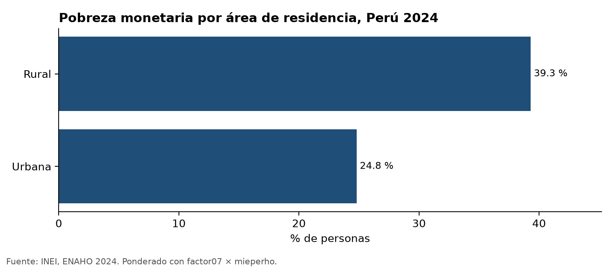
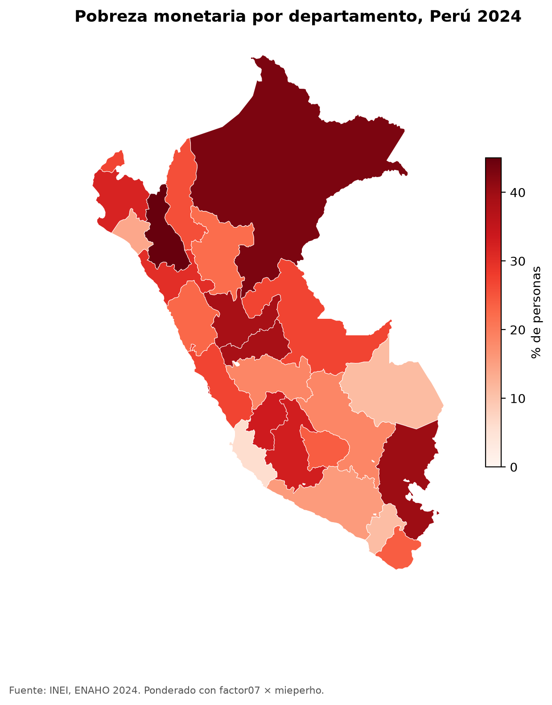

# Skills para la ENAHO

Cuatro skills de Claude Code que descargan, limpian, grafican y mapean la ENAHO 2024 del INEI, siempre de la misma forma. La limpieza replica la pobreza monetaria oficial: **27.6 %**.

| Skill | Qué hace | Entra | Sale |
|---|---|---|---|
| [`descargando-enaho`](.claude/skills/descargando-enaho/) | Baja los zip del INEI (2015–2024, cualquier módulo) y el GeoJSON | año, módulos | `datos/<año>/*.dta`, `datos/peru_departamental_simple.geojson` |
| [`limpiando-enaho`](.claude/skills/limpiando-enaho/) | Une miembros (02) y sumaria (34), filtra residentes y valida | `datos/2024/` | `salidas/personas_2024.parquet`, `salidas/hogares_2024.parquet`, [`salidas/validacion.txt`](salidas/validacion.txt) |
| [`graficando-enaho`](.claude/skills/graficando-enaho/) | Barras de pobreza por área, sexo, edad o departamento | la base limpia | `figuras/*.png` |
| [`mapeando-enaho`](.claude/skills/mapeando-enaho/) | Mapa por departamento, unido por código | la base limpia y el GeoJSON | `mapas/pobreza_departamento.png` |

Se encadenan solas: si falta la base limpia, `graficando` y `mapeando` llaman a `limpiando`; si faltan los datos, `limpiando` llama a `descargando`. Un solo pedido («haz un mapa de la pobreza por departamento») puede activar tres skills seguidas.

## Cómo usarlo

Requisitos: [uv](https://docs.astral.sh/uv/) y [Claude Code](https://code.claude.com).

```bash
git clone <este-repo> && cd Repositorio_Skills
uv sync
claude
```

Dentro de Claude Code, pide en lenguaje natural o llama a una skill con `/`:

```text
Haz un mapa de la pobreza por departamento con la ENAHO 2024
/descargando-enaho 2023
/limpiando-enaho 2024
/graficando-enaho sexo
```

### Sin Claude

Los scripts también corren solos, desde la raíz del repositorio:

```bash
uv run .claude/skills/descargando-enaho/scripts/descargar.py --anio 2024
uv run .claude/skills/limpiando-enaho/scripts/limpiar.py --anio 2024
uv run .claude/skills/graficando-enaho/scripts/graficar.py --por area
uv run .claude/skills/mapeando-enaho/scripts/mapear.py
```

`datos/` y el `.parquet` no se suben a git: se regeneran con los comandos de arriba.

## Validación

Resultado de [`salidas/validacion.txt`](salidas/validacion.txt):

| Chequeo | Resultado |
|---|---|
| Pobreza 2024 (sumaria, `factor07 × mieperho`) | 27.58 % (INEI: 27.6 %) |
| Pobreza extrema | 5.50 % |
| Residentes habituales | 108,664 de 117,721 filas |
| Llaves únicas, unión sin pérdidas ni duplicados, 25 departamentos | OK |

## Resultados

| Pobreza por área | Pobreza por departamento |
|---|---|
|  |  |

Más figuras en [`figuras/`](figuras/). La evaluación con y sin skills está en [`evaluacion.md`](evaluacion.md).

## Decisiones

- **Llaves como texto.** `conglome`, `ubigeo` y las demás conservan los ceros a la izquierda.
- **Residentes habituales.** `(p204==1 & p205==2) | (p204==2 & p206==1)`, la definición del INEI.
- **Unión `m:1` validada.** Si un hogar estuviera repetido, el script falla en vez de duplicar personas.
- **Ponderación.** Validación, mapa y cortes por departamento o área usan la fórmula oficial del INEI (sumaria, `factor07 × mieperho`), así que replican las cifras publicadas: Cajamarca 45.0 %, Ica 6.0 %, rural 39.3 %. Solo los cortes por sexo y edad usan la base de personas con `facpob07`. Ver [`reference.md`](.claude/skills/limpiando-enaho/reference.md).
- **Mapas por código.** `ubigeo[:2]` con `FIRST_IDDP`, nunca por nombre.
